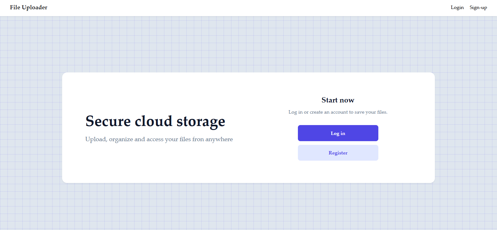
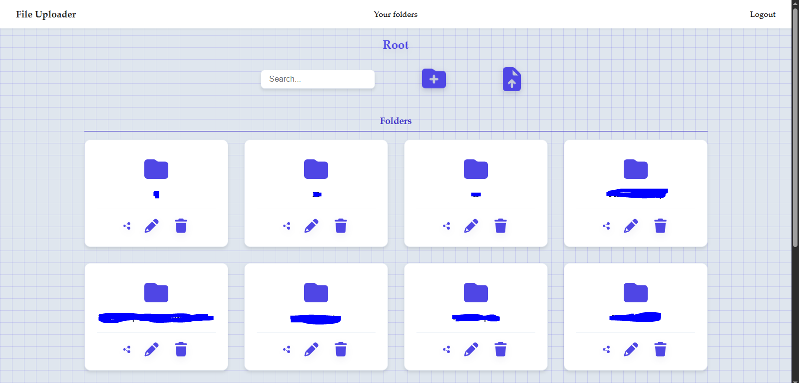

# 📁 File Uploader

> A Storage and file management web application, developed as part of the course from **The Odin Project**.  It features an aesthetic design reminiscent of a school notebook, a rigorous security system with data isolation per user, multimedia previews, and temporary sharing links.
---

## 🚀 Key Features

- **Authentication and Security:** Secure registration and login system using **Passport.js** and Express sessions.
- **Complete Data Isolation:** Strict ownership validation (`userId`) on every database query to prevent unauthorized cross-user access.
- **Mobile-First Design & Notebook Theme:** A responsive interface adapted for both mobile and desktop, featuring a notebook-style grid pattern created with pure CSS.
- **Hierarchical Management:** Create, edit, and delete folders and files, with built-in pagination for smooth performance.
- **Dynamic Preview:** Preview of files directly within the application, no need for immediate downloads
- **Server side search:** A backend-optimized search bar powered by Prisma, allowing for global filtering of folders and files.
- **Temporary Sharing Links:** Generate unique, token-protected public links with an automatic expiration date.

---

## 🛠️ Technologies Used

- **Environment:** Node.js
- **Backend Framework:** Express.js
- **Template Engine:** EJS (Embedded JavaScript Templates)
- **Database & ORM:** Prisma ORM (Compatible with PostgreSQL / SQLite)
- **Authentication:** Passport.js (Local Strategy)
- **File Handling:** Multer
- **Styling:** Modern CSS3 (CSS Variables, Flexbox, Grid)

---

## 👁️ Preview

### Index



### Folders section



---

## ⚙️ Local Installation and Setup

Follow these steps to clone and run the project on your local machine:

### Prerequisites
- Node.js installed on your system.
- Git.

### 1. Clone the repository

```bash
git clone [https://github.com/BarujHaro/FileUploader.git](https://github.com/BarujHaro/file-uploader.git)
cd file-uploader
```

### 2. ⚙️ Environment Setup
DATABASE_URL 
SESSION_SECRET 
JWT_SHARE_SECRET 
